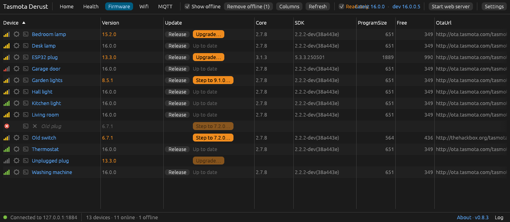
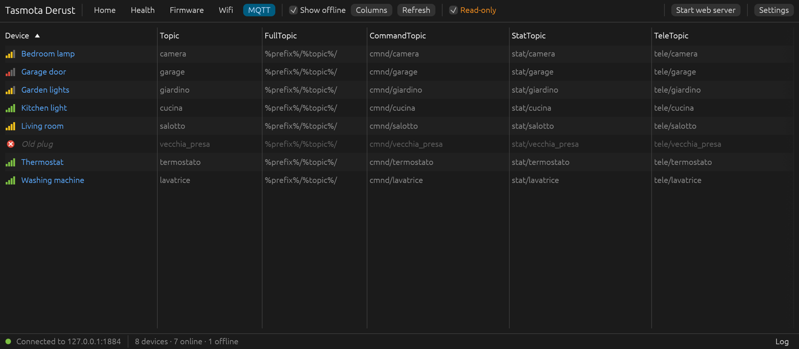
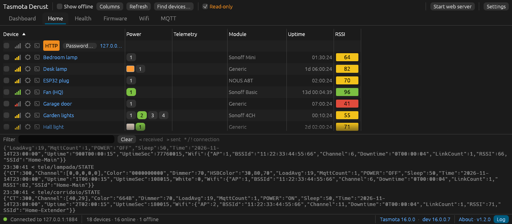
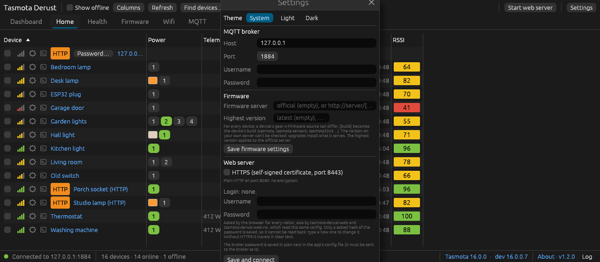
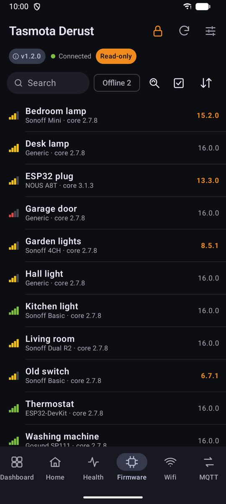
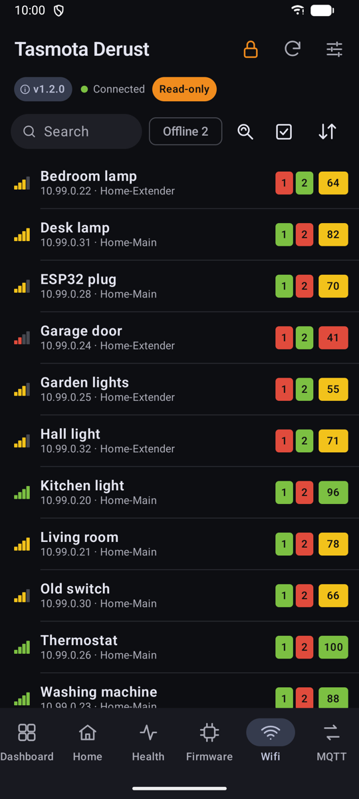
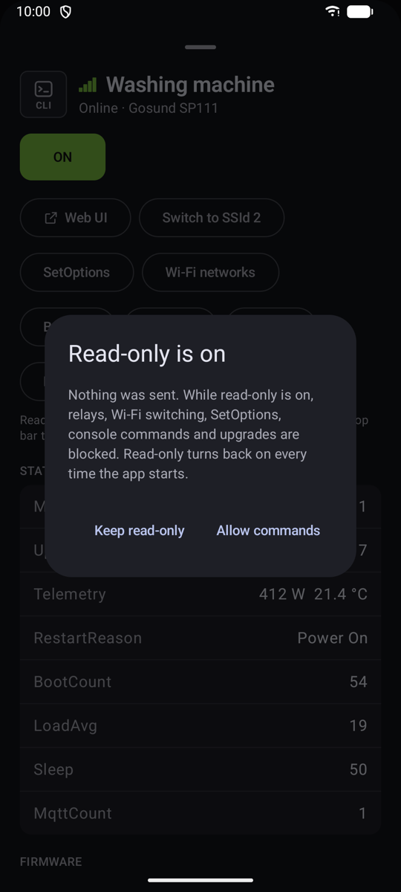

# Tasmota Derust

A modern manager for [Tasmota](https://tasmota.github.io/) devices, written in Rust:
a native desktop app (macOS, Windows, Linux), a web server for phones and browsers, and an
Android app.

Inspired by [TDM – Tasmota Device Manager](https://github.com/jziolkowski/tdm) by jziolkowski,
which is no longer maintained. Tasmota Derust is an independent rewrite (no code taken from TDM)
and is not affiliated with the Tasmota project.

- [Download](#download)
- [Features](#features-v01) · [Screenshots](#screenshots)
- [Desktop app](#desktop-app) · [Web version](#web-version) · [Android app](#android-app)
- **Building, development, releases**: see [DEVELOPMENT.md](DEVELOPMENT.md)

## Download

Ready-made builds are attached to each [GitHub release](../../releases):

| | Desktop app | Web server |
|---|---|---|
| macOS (Apple Silicon) | `tasmota-derust-<version>-macos-arm64.dmg` | `tasmota-derust-web-<version>-macos-arm64.zip` |
| Windows x64 | `tasmota-derust-<version>-windows-x64.zip` | `tasmota-derust-web-<version>-windows-x64.zip` |
| Linux x64 (glibc 2.31+) | `tasmota-derust-<version>-linux-x64.tar.gz` | `tasmota-derust-web-<version>-linux-x64.tar.gz` |
| Android 13+ | `tasmota-derust-<version>.apk` | |

The builds are not notarized or code-signed by a store:

- **macOS**: open the `.dmg` and drag the app to *Applications*; the first time, right-click
  the app and choose *Open*.
- **Windows**: if SmartScreen appears, choose *More info > Run anyway*.
- **Android**: allow installing apps from the app you open the APK with (Files, a browser, a
  chat app); Play Protect may ask for confirmation because the app is not from the Play Store.

Every archive and disk image contains the licenses, its Trivy vulnerability report
(`TRIVY-REPORT.txt`) and `SHA256SUMS` of the files inside. The release also has `SHA256SUMS`
of the downloads and `security-reports.zip` (all reports and SBOMs, see
[Releases and CI](DEVELOPMENT.md#releases-and-ci)).

### Code signing policy

Windows releases use free code signing provided by [SignPath.io](https://about.signpath.io),
certificate by [SignPath Foundation](https://signpath.org) (application in progress: until it
is approved, the Windows executables are not signed).

- Committers and reviewers: [fragolinux](https://github.com/fragolinux)
- Approvers: [fragolinux](https://github.com/fragolinux)

Every signed file is built by the `release.yml` workflow from this repository, and every
signing request is approved by hand.

### Privacy

This program will not transfer any information to other networked systems unless
specifically requested by the user or the person installing or operating it. It only
connects to the MQTT broker you configure (and to your devices' own web pages when you open
them), asks GitHub for the version numbers of the latest Tasmota release and development
build (to mark outdated firmware) and of the latest Tasmota Derust release (to say when a
newer one is out), and asks ota.tasmota.com for the size of a firmware image before an
upgrade step. Nothing about you or your devices is sent anywhere.

## Features

- Connects to your MQTT broker and discovers Tasmota devices automatically
  (native `tasmota/discovery` messages, plus LWT-based discovery for older firmware).
- One global device list with five views: **Home, Health, Firmware, Wifi, MQTT**.
- Relay buttons inline on each row: one click toggles the relay.
- Show or hide devices that the broker knows about but that are currently offline.
- Per-view column chooser (show/hide, reorder), saved between runs.
- Click a device name to open its web UI.
- Telemetry column with the main live value (power in W, temperature, humidity).
- Wifi view: legend of the two configured SSIDs; click the AP cell to switch a device
  to the other SSID (asks for confirmation, sends `Ap <n>`, device restarts).
- Firmware view: compares each device with the latest official Tasmota release (or the
  latest development build, when its OtaUrl points there) and upgrades **one device at a
  time**, with a confirmation and progress tracking. Devices already up to date show
  "Up to date" instead of the button; a device being upgraded stays in the list while it
  restarts.
- **Upgrade path for old firmware** (ESP8266): from 4.2.0 up, the official steps
  5.14.0 → 6.7.1 → 7.2.0 → 8.5.1 → 9.1 → latest, one confirmed step at a time. Before each
  step the free flash is checked against the image size (Tasmota goes through its
  `-minimal` image by itself when needed), `.gz` images are used only from 8.2 on, and the
  version is verified after the restart. If a step fails, upgrading again continues from
  wherever the device is.
- **Release / development switch**: one click points a device's OtaUrl at the official
  release builds or at the development builds (same image, ESP8266 and ESP32); the upgrade
  button then shows whether there is something to install.
- Message log panel for troubleshooting.
- **Read-only mode**, on at every start: only read queries (`Status 0`, `Module`, `SSId1/2`)
  are sent, and relays, Wi-Fi switching and upgrades are refused. Trying one says that
  read-only is on and where to turn it off.

## Screenshots

All taken with the built-in [device simulator](DEVELOPMENT.md#trying-it-without-real-devices): no real
devices or network.

**Desktop** (macOS; Windows and Linux look the same):


| Health: uptime, restarts, load, signal | Firmware: outdated devices in orange |
|---|---|
|  |  |
| **Wifi: SSID, AP and network of each device** | **MQTT: topic, full topic, group and fallback topics** |
|  |  |
| **Message log** | **Broker settings** |
|  |  |

**Android**:

| Home | Health | Firmware | Wifi |
|---|---|---|---|
|  |  |  |  |
| **MQTT** | **Device details** | **Read-only** | **Settings** |
|  |  |  |  |

## Desktop app

Set the broker in **Settings** (host, port, user, password); the devices appear as they
report in. The toolbar has the views, *Show offline*, the column chooser, *Refresh*, the
**Read-only** checkbox (ticked at every start) and **Start web server**.

Settings are saved in plain text in the user's config directory:

| System | Config file |
|---|---|
| macOS | `~/Library/Application Support/tasmota-derust/config.json` |
| Windows | `%APPDATA%\tasmota-derust\config\config.json` |
| Linux | `~/.config/tasmota-derust/config.json` |

On Linux the desktop app needs OpenGL and either X11 or Wayland (any desktop session has them).

## Web version

`tasmota-derust-web` is a small server with the same MQTT core. It serves a page that works
on phones, tablets and desktop browsers: tables on wide screens, and on phones a compact list
with a bottom tab bar and a detail sheet per device.

```
tasmota-derust-web                          # listens on 0.0.0.0:8080
tasmota-derust-web --listen 127.0.0.1:8099  # local only
tasmota-derust-web --read-only              # look, but never switch, restart or upgrade
```

It prints the address to open from other devices (this computer's network address, e.g.
`http://192.168.1.20:8080`). It reads the broker from the desktop app's config file;
environment variables override it: `DERUST_MQTT_HOST`, `DERUST_MQTT_PORT`, `DERUST_MQTT_USER`,
`DERUST_MQTT_PASSWORD`, plus `DERUST_LISTEN` and `DERUST_READ_ONLY=1`.

The desktop app can run the same server: **Start web server** listens on port 8080, shows the
address, and follows the app's Read-only checkbox, also when it changes while the server runs.

There is no login yet: run it only on a trusted network, or in read-only mode.

## Android app

`android/` is a Kotlin + Jetpack Compose app for Android 13 or newer. The device logic is the
same Rust core, compiled for Android with `cargo-ndk` and called from Kotlin through UniFFI
(`crates/mobile`); Gradle builds the Rust part automatically.

Broker settings are entered in the app, stored only on the phone and excluded from backups.
**Read-only is on at every start**: commands are sent only after opening the lock in the top
bar (it asks first). On Android 17 the app asks for permission to reach devices on the local
network.

## Building and contributing

Building every version (macOS, Windows, Linux, Android) with or without `make`, the device
simulator, the Trivy security checks and the release process are in
[DEVELOPMENT.md](DEVELOPMENT.md). The architecture and roadmap are in [DESIGN.md](DESIGN.md).

## Status

The basic functions are all there: discovery, the device views, relays, Wi-Fi AP switching,
firmware upgrades from the device's OtaUrl, read-only mode, desktop, web and Android.

Missing, compared with tdmgr: the advanced editors in its top tabs (rules, timers, switches,
buttons, power settings and the like) and a per-device console. See the roadmap in
[DESIGN.md](DESIGN.md#roadmap).

## License

Licensed under either of

- Apache License, Version 2.0 ([LICENSE-APACHE](LICENSE-APACHE) or <http://www.apache.org/licenses/LICENSE-2.0>)
- MIT license ([LICENSE-MIT](LICENSE-MIT) or <http://opensource.org/licenses/MIT>)

at your option.

Unless you explicitly state otherwise, any contribution intentionally submitted
for inclusion in this project by you, as defined in the Apache-2.0 license,
shall be dual licensed as above, without any additional terms or conditions.
