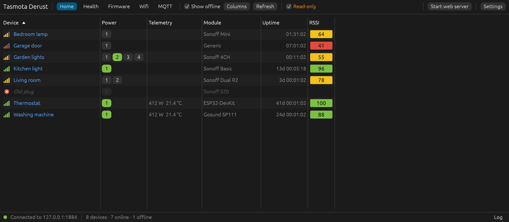
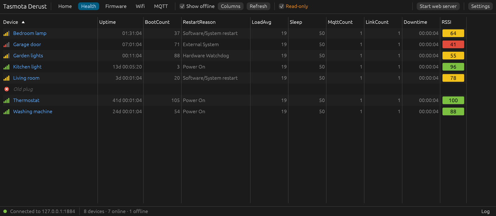
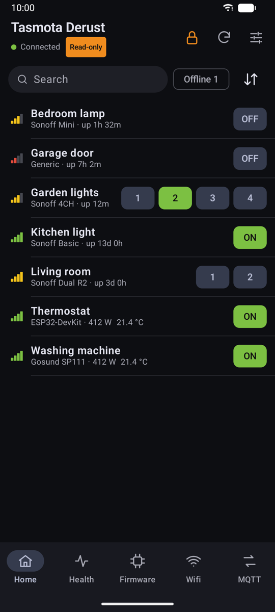
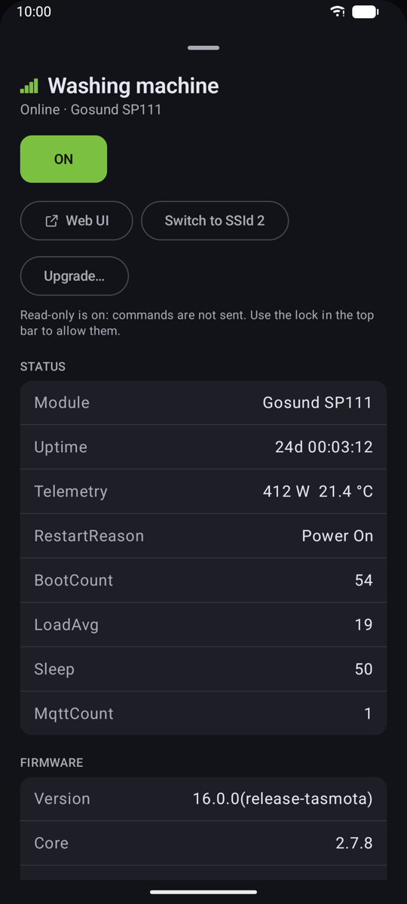
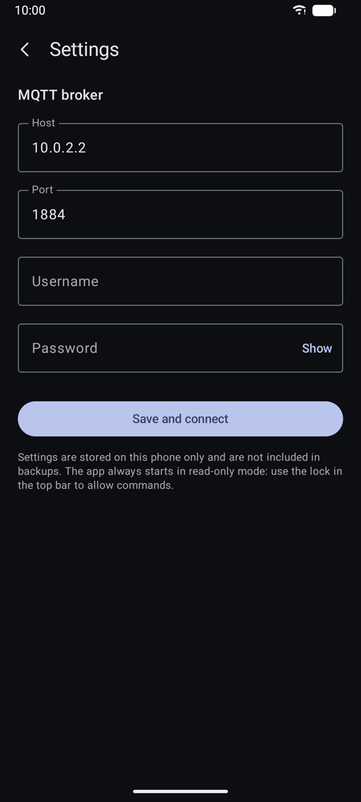

# Tasmota Derust

A modern manager for [Tasmota](https://tasmota.github.io/) devices, written in Rust:
a native desktop app (macOS, Windows, Linux), a web server for phones and browsers, and an
Android app.

Inspired by [TDM – Tasmota Device Manager](https://github.com/jziolkowski/tdm) by jziolkowski,
which is no longer maintained. Tasmota Derust is an independent rewrite (no code taken from TDM)
and is not affiliated with the Tasmota project.

- [Download](#download)
- [Features](#features-v01) · [Screenshots](#screenshots)
- [Desktop app](#desktop-app) · [Web version](#web-version) · [Android app](#android-app)
- [Building from source](#building-from-source): [tools](#what-you-need),
  [setup per system](#setting-up-the-tools), [with make](#building-with-make),
  [without make](#building-without-make), [security scan](#security-scan-with-trivy)
- [Development](#development) · [Releases](#releases-and-ci) · [Project layout](#project-layout)

## Download

Ready-made builds are attached to each [GitHub release](../../releases):

| | Desktop app | Web server |
|---|---|---|
| macOS (Apple Silicon) | `tasmota-derust-<version>-macos-arm64.zip` | `tasmota-derust-web-<version>-macos-arm64.tar.gz` |
| Windows x64 | `tasmota-derust-<version>-windows-x64.zip` | `tasmota-derust-web-<version>-windows-x64.zip` |
| Linux x64 (glibc 2.31+) | `tasmota-derust-<version>-linux-x64.tar.gz` | `tasmota-derust-web-<version>-linux-x64.tar.gz` |
| Android 13+ | `tasmota-derust-<version>.apk` | |

The builds are not notarized or code-signed by a store:

- **macOS**: the first time, right-click the app and choose *Open*.
- **Windows**: if SmartScreen appears, choose *More info > Run anyway*.
- **Android**: allow installing apps from the app you open the APK with (Files, a browser, a
  chat app); Play Protect may ask for confirmation because the app is not from the Play Store.

Every release also has `SHA256SUMS` and `security-reports.zip` (vulnerability scan and SBOM
of each file, see [Releases and CI](#releases-and-ci)).

## Features (v0.1)

- Connects to your MQTT broker and discovers Tasmota devices automatically
  (native `tasmota/discovery` messages, plus LWT-based discovery for older firmware).
- One global device list with five views: **Home, Health, Firmware, Wifi, MQTT**.
- Relay buttons inline on each row: one click toggles the relay.
- Show or hide devices that the broker knows about but that are currently offline.
- Per-view column chooser (show/hide, reorder), saved between runs.
- Click a device name to open its web UI.
- Telemetry column with the main live value (power in W, temperature, humidity).
- Wifi view: legend of the two configured SSIDs; click the AP cell to switch a device
  to the other SSID (asks for confirmation, sends `Ap <n>`, device restarts).
- Firmware view: compares each device with the latest official Tasmota release and lets you
  upgrade **one device at a time** (confirmation, `Upgrade 1`, progress tracking).
- Message log panel for troubleshooting.
- **Read-only mode**, on at every start: only read queries (`Status 0`, `Module`, `SSId1/2`)
  are sent, and relays, Wi-Fi switching and upgrades are refused. Trying one says that
  read-only is on and where to turn it off.

## Screenshots

All taken with the built-in [device simulator](#trying-it-without-real-devices): no real
devices or network.

**Desktop** (macOS; Windows and Linux look the same):



| Health: uptime, restarts, load, signal | Firmware: outdated devices in orange |
|---|---|
|  |  |
| **Wifi: SSID, AP and network of each device** | **MQTT: topic, full topic, group and fallback topics** |
|  |  |
| **Message log** | **Broker settings** |
|  |  |

**Android**:

| Home | Health | Firmware | Wifi |
|---|---|---|---|
|  |  |  |  |
| **MQTT** | **Device details** | **Read-only** | **Settings** |
|  |  |  |  |

## Desktop app

Set the broker in **Settings** (host, port, user, password); the devices appear as they
report in. The toolbar has the views, *Show offline*, the column chooser, *Refresh*, the
**Read-only** checkbox (ticked at every start) and **Start web server**.

Settings are saved in plain text in the user's config directory:

| System | Config file |
|---|---|
| macOS | `~/Library/Application Support/tasmota-derust/config.json` |
| Windows | `%APPDATA%\tasmota-derust\config\config.json` |
| Linux | `~/.config/tasmota-derust/config.json` |

On Linux the desktop app needs OpenGL and either X11 or Wayland (any desktop session has them).

## Web version

`tasmota-derust-web` is a small server with the same MQTT core. It serves a page that works
on phones, tablets and desktop browsers: tables on wide screens, and on phones a compact list
with a bottom tab bar and a detail sheet per device.

```
tasmota-derust-web                          # listens on 0.0.0.0:8080
tasmota-derust-web --listen 127.0.0.1:8099  # local only
tasmota-derust-web --read-only              # look, but never switch, restart or upgrade
```

It prints the address to open from other devices (this computer's network address, e.g.
`http://192.168.1.20:8080`). It reads the broker from the desktop app's config file;
environment variables override it: `DERUST_MQTT_HOST`, `DERUST_MQTT_PORT`, `DERUST_MQTT_USER`,
`DERUST_MQTT_PASSWORD`, plus `DERUST_LISTEN` and `DERUST_READ_ONLY=1`.

The desktop app can run the same server: **Start web server** listens on port 8080, shows the
address, and follows the app's Read-only checkbox, also when it changes while the server runs.

There is no login yet: run it only on a trusted network, or in read-only mode.

## Android app

`android/` is a Kotlin + Jetpack Compose app for Android 13 or newer. The device logic is the
same Rust core, compiled for Android with `cargo-ndk` and called from Kotlin through UniFFI
(`crates/mobile`); Gradle builds the Rust part automatically.

Broker settings are entered in the app, stored only on the phone and excluded from backups.
**Read-only is on at every start**: commands are sent only after opening the lock in the top
bar (it asks first). On Android 17 the app asks for permission to reach devices on the local
network.

## Building from source

### What you need

| Tool | Needed for | macOS | Debian / Ubuntu | Windows |
|---|---|---|---|---|
| [Rust](https://rustup.rs) (rustup, stable) | everything | rustup.rs script | rustup.rs script | rustup-init.exe from rustup.rs |
| C toolchain | everything | `xcode-select --install` | `sudo apt install build-essential` | Visual Studio Build Tools, "Desktop development with C++" |
| GNU make, git, zip | the Makefile | included (Xcode tools) | `sudo apt install make git zip` | use the [commands without make](#building-without-make) |
| mingw-w64 | Windows builds from macOS/Linux | `brew install mingw-w64` | `sudo apt install gcc-mingw-w64-x86-64` | not needed |
| zig + cargo-zigbuild | Linux builds (any host) | `brew install zig` | [ziglang.org](https://ziglang.org/download/) | — |
| cargo-auditable | dependency list inside the binaries (for scanning) | `cargo install --locked cargo-auditable` | same | same |
| Android Studio (SDK, NDK 30.0.16248370, JDK) | the APK | [developer.android.com/studio](https://developer.android.com/studio) | same | same |
| cargo-ndk + Android Rust targets | the APK | see below | same | same |
| Trivy | security scan | `brew install trivy` | [trivy.dev install](https://trivy.dev/latest/getting-started/installation/) | same |
| mosquitto | the device simulator | `brew install mosquitto` | `sudo apt install mosquitto` | mosquitto.org |

Only Rust and a C toolchain are needed for a plain `cargo run`. The rest depends on what you
build. macOS builds can only be made on a Mac; everything else can be built from macOS or Linux.

### Setting up the tools

**macOS** (the reference setup: it builds every target):

```
xcode-select --install
brew install mingw-w64 zig trivy mosquitto
curl --proto '=https' --tlsv1.2 -sSf https://sh.rustup.rs | sh -s -- -y && source ~/.cargo/env
rustup target add x86_64-pc-windows-gnu x86_64-unknown-linux-gnu \
    aarch64-linux-android armv7-linux-androideabi x86_64-linux-android
cargo install --locked cargo-auditable cargo-zigbuild cargo-ndk
```

Then Android Studio: install it, open *Settings > Languages & Frameworks > Android SDK*, and in
*SDK Tools* tick **NDK (Side by side)** version 30.0.16248370 and **Android SDK Build-Tools**.
Open the `android/` folder once so Gradle downloads what it needs. The Makefile expects the SDK
in `~/Library/Android/sdk` and Android Studio's JDK; set `ANDROID_HOME` / `JAVA_HOME` if yours
are elsewhere.

**Debian / Ubuntu**: same Rust commands; `sudo apt install build-essential make git zip
gcc-mingw-w64-x86-64 mosquitto`, zig from ziglang.org on the `PATH`, Trivy from its install
page. For the APK, Android Studio for Linux (or the command-line tools) with the same NDK,
and `ANDROID_HOME` / `JAVA_HOME` exported.

**Windows**: rustup and Visual Studio Build Tools are enough for the desktop app and the web
server (`cargo build --profile dist -p tasmota-derust`, see below). For the APK, Android
Studio plus the Android Rust targets and cargo-ndk.

`make check-tools` lists what is installed and what is missing, with the command to fix it.

### Building with make

Every artifact lands in `dist/`, size-optimized:

| Command | Output |
|---|---|
| `make mac-desktop` | `dist/mac/Tasmota Derust.app` (Apple Silicon) |
| `make mac-web` | `dist/mac/tasmota-derust-web` |
| `make win-desktop` | `dist/windows/tasmota-derust.exe` (x64) |
| `make win-web` | `dist/windows/tasmota-derust-web.exe` |
| `make linux-desktop` | `dist/linux/tasmota-derust` (x64, glibc 2.31+) |
| `make linux-web` | `dist/linux/tasmota-derust-web` |
| `make apk` | `dist/android/tasmota-derust.apk` (arm64 + armv7) |

Groups: `make mac`, `make windows`, `make linux`, `make desktop`, `make web`. `make` alone
builds everything and prints the sizes. Then:

| Command | What it does |
|---|---|
| `make package` | release archives of `dist/` in `dist/release/`, with `SHA256SUMS` |
| `make scan` | Trivy scan of those archives, reports in `dist/security/` |
| `make sizes` | sizes of what is in `dist/` |
| `make release-key` | creates the APK signing key (once, see [Releases](#releases-and-ci)) |
| `make lock-android` | refreshes `android/app/gradle.lockfile` after changing Android dependencies |
| `make check-tools` | what is missing |
| `make clean` | removes `dist/` (Cargo's `target/` stays, so builds stay fast) |

The APK is signed with `~/.android/tasmota-derust-release.jks` when it exists (password from
`DERUST_KEYSTORE_PASSWORD`, or asked), otherwise with Android Studio's debug key. APKs signed
with different keys don't install over each other: changing key means uninstalling once.

Why the files are small: the `dist` Cargo profile uses `opt-level = "s"`, fat LTO, one codegen
unit, `panic = "abort"` and full strip; the desktop app draws with OpenGL (glow) instead of
wgpu; the Android library keeps unwinding (UniFFI turns panics into exceptions) and release
APKs leave out the emulator-only x86_64 code.

### Building without make

What each `make` target runs, for doing it by hand (or on Windows). Drop `auditable` if you
didn't install cargo-auditable.

```
# Desktop app and web server for the computer you are on (macOS, Windows or Linux)
cargo auditable build --locked --profile dist -p tasmota-derust -p tasmota-derust-web
#   -> target/dist/tasmota-derust[.exe], target/dist/tasmota-derust-web[.exe]

# macOS app bundle
mkdir -p "dist/mac/Tasmota Derust.app/Contents/MacOS"
cp target/dist/tasmota-derust "dist/mac/Tasmota Derust.app/Contents/MacOS/"
sed 's/@VERSION@/0.1.0/g' packaging/macos/Info.plist > "dist/mac/Tasmota Derust.app/Contents/Info.plist"
codesign --force --sign - "dist/mac/Tasmota Derust.app"

# Windows from macOS/Linux (mingw-w64)
cargo auditable build --locked --profile dist --target x86_64-pc-windows-gnu \
    -p tasmota-derust -p tasmota-derust-web
#   -> target/x86_64-pc-windows-gnu/dist/*.exe

# Linux from any system (zig), for glibc 2.31 and newer
cargo auditable zigbuild --locked --profile dist --target x86_64-unknown-linux-gnu.2.31 \
    -p tasmota-derust -p tasmota-derust-web
#   -> target/x86_64-unknown-linux-gnu/dist/

# Android: Gradle runs cargo-ndk and UniFFI by itself (task rustCore)
cd android && ./gradlew assembleRelease
#   -> android/app/build/outputs/apk/release/app-release-unsigned.apk, then align and sign:
zipalign -f -p 4 app-release-unsigned.apk aligned.apk
apksigner sign --ks ~/.android/tasmota-derust-release.jks --ks-key-alias tasmota-derust \
    --out tasmota-derust.apk aligned.apk
# (zipalign and apksigner are in $ANDROID_HOME/build-tools/<version>/)

# Archives and checksums
bash scripts/package.sh dist dist/release 0.1.0
```

For day-to-day work: `cargo run --release` (desktop app), `cargo run --release -p
tasmota-derust-web -- --read-only`, `cd android && ./gradlew installDebug` (APK on a connected
phone or emulator), or *Run* in Android Studio.

### Security scan with Trivy

Two checks, the same ones the GitHub workflows run.

**Dependencies of the source tree** (fast, nothing to build): `Cargo.lock` covers every Rust
crate, `android/app/gradle.lockfile` the APK's Java/Kotlin libraries; `secret` looks for
committed passwords and keys.

```
trivy fs --scanners vuln,secret --skip-dirs target --skip-dirs dist \
    --skip-dirs android/app/build --skip-dirs android/build --skip-dirs android/.gradle .
```

**The files you ship** (after `make` and `make package`):

```
make scan        # = bash scripts/scan-artifacts.sh dist/release dist/security
```

Each archive is unpacked and scanned with `trivy rootfs`. Thanks to cargo-auditable, Trivy
reads the exact crates inside each binary (and inside the APK's native library); the APK's
Java/Kotlin side is checked through the Gradle lockfile. For every archive you get
`<name>.trivy.txt` (readable table), `<name>.trivy.json` and `<name>.cdx.json` (CycloneDX
SBOM), plus `SUMMARY.md`. The scan fails when it finds a HIGH or CRITICAL vulnerability that
already has a fixed version, or a binary without dependency data (built without
cargo-auditable); `SCAN_NO_FAIL=1 make scan` only reports.

By hand, for a single file:

```
mkdir /tmp/scan && tar -xzf dist/release/tasmota-derust-web-0.1.0-linux-x64.tar.gz -C /tmp/scan
trivy rootfs --scanners vuln /tmp/scan
```

## Development

### Trying it without real devices

`crates/core/examples/simulator.rs` plays a few fake Tasmota devices on a **local** broker
(it refuses any broker that is not on this computer). It answers the read queries and the
commands (relays, AP switch, upgrade), so every screen can be tried safely:

```
mosquitto -p 1884
cargo run -p tasmota-derust-core --example simulator -- 127.0.0.1:1884
```

Then point the app at `127.0.0.1`, port `1884`. From the Android emulator the computer is
`10.0.2.2`; from a phone on USB, `adb reverse tcp:1884 tcp:1884` and use `127.0.0.1`.

### Other tools

- README screenshots: `cargo run --release -p tasmota-derust --features screenshots` with
  `DERUST_SCREENSHOTS=<dir>` walks through the desktop screens, saves a PNG of each and
  quits. Run it with the simulator and a separate config (e.g. `HOME=/tmp/demo-home` on
  macOS/Linux, with a config pointing at `127.0.0.1:1884`), so it never touches a real broker.
  The feature is development-only and never part of `make` builds.

- `cargo test --workspace` runs the tests (the web one starts the server on a free port).
- `cargo run -p tasmota-derust-core --example probe [seconds]` listens to the configured broker
  and prints what was understood. It is passive and never publishes.

## Releases and CI

GitHub Actions (`.github/workflows/`):

- **Security** (`security.yml`), on every push and pull request and weekly: the Trivy source
  scan above. It fails on committed secrets and on HIGH/CRITICAL vulnerabilities that have a
  fix. Nothing is built.
- **Release** (`release.yml`), only when a version tag is pushed: builds macOS, Linux, Windows
  and the APK, smoke-tests the Linux web server, packs everything, scans **the finished
  archives** with Trivy, and only then publishes the GitHub release. A failing scan stops it
  before anything is published. The scan summary goes into the release notes; the full
  reports and SBOMs are attached as `security-reports.zip`.

One-time setup, for signed APKs:

1. `make release-key` creates `~/.android/tasmota-derust-release.jks` (you choose the
   password). Keep a backup of the file and the password: without them, new versions of the
   app no longer install over the old ones.
2. In the GitHub repository, *Settings > Secrets and variables > Actions*, add
   `ANDROID_KEYSTORE_BASE64` (output of `base64 -i ~/.android/tasmota-derust-release.jks`)
   and `ANDROID_KEYSTORE_PASSWORD`.

To release: set the version in `Cargo.toml` (`[workspace.package]`; the Android app takes its
version from there too), commit, then tag with the same version and push the tag:

```
git tag v0.2.0
git push origin v0.2.0
```

The workflow checks that the tag matches `Cargo.toml`. Tags with a suffix (`v0.2.0-rc1`)
become pre-releases. *Actions > Release > Run workflow* runs it as a dry run: everything is
built and scanned (with a throwaway APK key if the secrets are not set yet), nothing is
published. Dependabot (`.github/dependabot.yml`) opens weekly update PRs for the Rust crates
and the pinned GitHub Actions. Security reports: see [SECURITY.md](SECURITY.md).

## Project layout

| Path | What |
|---|---|
| `crates/core` | Device model, MQTT, settings, `Session` (store + commands with the read-only guard), simulator and probe examples |
| `crates/desktop` | Desktop app (egui), binary `tasmota-derust` |
| `crates/web` | Web server (axum): library used by the desktop app, binary `tasmota-derust-web`, page `index.html` |
| `crates/mobile` | Android library (UniFFI) |
| `crates/uniffi-bindgen` | Build tool that generates the Kotlin bindings |
| `android/` | Android app (Kotlin, Jetpack Compose) |
| `packaging/` | macOS `Info.plist` |
| `scripts/` | Packaging and security scan, used by the Makefile and the workflows |

See [DESIGN.md](DESIGN.md) for the architecture and the roadmap.

## Status

Early prototype.

## License

Licensed under either of

- Apache License, Version 2.0 ([LICENSE-APACHE](LICENSE-APACHE) or <http://www.apache.org/licenses/LICENSE-2.0>)
- MIT license ([LICENSE-MIT](LICENSE-MIT) or <http://opensource.org/licenses/MIT>)

at your option.

Unless you explicitly state otherwise, any contribution intentionally submitted
for inclusion in this project by you, as defined in the Apache-2.0 license,
shall be dual licensed as above, without any additional terms or conditions.
