# Tasmota Derust

A modern manager for [Tasmota](https://tasmota.github.io/) devices, written in Rust:
a native desktop app (macOS, Windows, Linux), a web server for phones and browsers, and an
Android app.

Inspired by [TDM – Tasmota Device Manager](https://github.com/jziolkowski/tdm) by jziolkowski,
which is no longer maintained. Tasmota Derust is an independent rewrite (no code taken from TDM)
and is not affiliated with the Tasmota project.

- **[Website](https://fragolinux.github.io/tasmota-derust/)**: what it is, screenshots, downloads for every system
- [Download](#download)
- **[Upgrade very old Tasmota, safely](#upgrade-very-old-tasmota-safely)**: a [recorded run on a real device](docs/upgrade-path/README.md)
- [Overview](docs/OVERVIEW.md): where the project started, how it grew, what each version does
- [Tasmota SetOption defaults: firmware vs documentation](docs/tasmota-setoption-report.md): wrong defaults and dropped upgrade steps found along the way, for the Tasmota developers
- [Features](#features) · [Screenshots](#screenshots)
- [Desktop app](#desktop-app) · [Web version](#web-version) · [Android app](#android-app)
- **Building, development, releases**: see [DEVELOPMENT.md](DEVELOPMENT.md)

## Upgrade very old Tasmota, safely

Devices still on old firmware (6.x, 7.x, 8.x) can't jump straight to the latest release:
Tasmota requires its [upgrade path](https://tasmota.github.io/docs/Upgrading/#upgrade-flow),
5.14 → 6.7.1 → 7.2.0 → 8.5.1 → 9.1 → latest, with the right image at each step. Tasmota
Derust does it for you, one confirmed step at a time:

- it sets the official image for each step (old devices often still point at dead OtaUrls),
  `.bin` until 8.2 and `.gz` after;
- before each step it checks the free flash against the image size, and tells you when
  Tasmota will go through its minimal image first;
- it follows every restart and checks the version, then offers the next step; if a step
  fails, upgrading again continues from wherever the device is;
- devices older than 10.0, ESP8266 and ESP32 alike, also stop at **16.0.0** once a newer
  release is out: it is the last release that still migrates their settings (newer ones skip
  those steps). ESP32 devices get the 16.0.0 image of their own build or chip (`tasmota32c3`,
  `tasmota32s3`…);
- one device at a time, with read-only mode as the safety lock.


**[See the whole run on a real ESP8266](docs/upgrade-path/README.md)**: 6.7.1 to 16.0.0
in four steps and under three minutes, with a screenshot of every state and the full log.

## Download

Ready-made builds are attached to each [GitHub release](../../releases):

| | Desktop app | Web server |
|---|---|---|
| macOS (Apple Silicon) | `tasmota-derust-<version>-macos-arm64.dmg` | `tasmota-derust-web-<version>-macos-arm64.zip` |
| Windows x64 | `tasmota-derust-<version>-windows-x64.zip` | `tasmota-derust-web-<version>-windows-x64.zip` |
| Linux x64 (glibc 2.31+) | `tasmota-derust-<version>-linux-x64.tar.gz` | `tasmota-derust-web-<version>-linux-x64.tar.gz` |
| Android 13+ | `tasmota-derust-<version>.apk` | |

The builds are not notarized or code-signed by a store:

- **macOS**: open the `.dmg` and drag the app to *Applications*; the first time, right-click
  the app and choose *Open*.
- **Windows**: if SmartScreen appears, choose *More info > Run anyway*.
- **Android**: allow installing apps from the app you open the APK with (Files, a browser, a
  chat app); Play Protect may ask for confirmation because the app is not from the Play Store.

Every archive and disk image contains the licenses, its Trivy vulnerability report
(`TRIVY-REPORT.txt`) and `SHA256SUMS` of the files inside. The release also has `SHA256SUMS`
of the downloads and `security-reports.zip` (all reports and SBOMs, see
[Releases and CI](DEVELOPMENT.md#releases-and-ci)).

### Privacy

This program will not transfer any information to other networked systems unless
specifically requested by the user or the person installing or operating it. It only
connects to the MQTT broker you configure (and to your devices' own web pages when you open
them), asks GitHub for the version numbers of the latest Tasmota release and development
build (to mark outdated firmware) and of the latest Tasmota Derust release (to say when a
newer one is out; at start and then once an hour) and its release notes when you open them, asks ota.tasmota.com for the size of a firmware image before an
upgrade step, talks to a device's own web server when you back it up or restore it, and downloads the SetOption descriptions from the Tasmota documentation on
GitHub the first time you open a SetOptions window. Nothing about you or your devices is sent anywhere.

## Features

- Connects to your MQTT broker and discovers Tasmota devices automatically
  (native `tasmota/discovery` messages, plus LWT-based discovery for older firmware).
- One global device list with six views: **Dashboard, Home, Health, Firmware, Wifi, MQTT**.
- **Dashboard**, the first view at every start: one card per device with big relay buttons,
  the light's colour (a tap opens colour and brightness) and its main values (power and
  temperature, or uptime). Choosing the values shown on the cards is planned.
- **Group upgrades**: tick devices and upgrade them all at once. Each one upgrades on its own,
  at the same time as the others; a failure stops only that device, and old firmware goes
  through the upgrade path step after step by itself.
- **Firmware server and highest version**, for every device (Settings) and per device (gear >
  Firmware source, or the device sheet): your own OTA server as a URL with `{build}` (e.g.
  `http://192.168.1.5/fw/{build}.bin.gz`, where `{build}` becomes `tasmota`,
  `tasmota-sensors`, `tasmota32c3`…; its version can't be checked, so the upgrade installs
  what it serves), or the official server with a highest version (e.g. `11.1.0`: upgrades stop
  at that release, devices already there are left alone).
- **Find devices on the network** (Find…): asks every address of the local network (or a
  range you give) for its status over HTTP, read-only, and adds the Tasmota devices that are
  not on MQTT to the list, marked **HTTP**: relays, console and status work over HTTP. Tick
  them and **Enable MQTT** sends the broker settings in one Backlog (MQTT on, host, port, user,
  password: the app's own by default); they restart and join MQTT, where their HTTP entry
  gives way to the MQTT one. Devices with a web password ask for it (kept only in memory).
- Relay buttons inline on each row: one click toggles the relay.
- **Lights**: dimmable, CCT, RGB, RGBW and RGBCCT lights show their colour next to the relay
  buttons; a colour wheel and sliders set colour, brightness, white temperature and white
  (`HSBColor`, `Dimmer`, `CT`, `White`), each only when the light has it.
- Show or hide devices that the broker knows about but that are currently offline (hidden at
  every start). An offline device has a ✕ in place of its gear: it is removed from the list
  and from the broker (its retained messages), and every other open app drops it too.
- **Just plugged in?** A device that started in the last 5 minutes (plugged in or restarted)
  gets a ★ next to its name and an amber row, on the desktop, the web page and Android. It goes
  by the device's uptime, so one that only reconnects (a Wi-Fi drop, a broker restart) is not
  marked.
- **Remove offline devices**, one (✕ next to the name, *Remove from list* on the phone) or all at
  once (*Remove offline*): they leave the list and the retained messages the broker keeps for
  them (last will, discovery…) are cleared, so they do not come back. A device that comes back
  online shows up again by itself. Not in read-only mode.
- Per-view column chooser (show/hide, reorder), saved between runs.
- Click a device name to open its web UI.
- Telemetry column with the main live value (power in W, temperature, humidity).
- Wifi view: legend of the two configured SSIDs; click the AP cell to switch a device
  to the other SSID (asks for confirmation, sends `Ap <n>`, device restarts).
- Firmware view: compares each device with the latest official Tasmota release (or the
  latest development build, when its OtaUrl points there) and upgrades **one device at a
  time**, with a confirmation and progress tracking. Devices already up to date show
  "Up to date" instead of the button; a device being upgraded stays in the list while it
  restarts.
- **Upgrade path for old firmware** (ESP8266, [see it on a real device](docs/upgrade-path/README.md)): from 4.2.0 up, the official steps
  5.14.0 → 6.7.1 → 7.2.0 → 8.5.1 → 9.1 → latest, one confirmed step at a time (with a stop at
  16.0.0 before any newer release, the last one that migrates settings older than 10.0; on
  ESP32 too, from 9.1 up). Before each
  step the free flash is checked against the image size (Tasmota goes through its
  `-minimal` image by itself when needed), `.gz` images are used only from 8.2 on, and the
  version is verified after the restart. If a step fails, upgrading again continues from
  wherever the device is.
- **Release / development switch**: one click points a device's OtaUrl at the official
  release builds or at the development builds (same image, ESP8266 and ESP32); the upgrade
  button then shows whether there is something to install.
- **SetOptions**: the ⚙ next to a device name (on phones: *SetOptions* in the device sheet)
  lists all its SetOptions, decoded from `Status 3` like Tasmota's `decode-status.py`, grouped
  by category, with a search box, *Only changed* (from the default), a switch for each on/off
  option and a number field for SO32–49. Each one is explained (the meaning of each value,
  the default) and links to the Tasmota documentation. Options that change how apps read the
  device (SO4, SO19, SO26, SO90) or that can make it misbehave (SO12, SO36, SO65, SO104, TLS…)
  ask first and say why; turning MQTT (SO3) or Wi-Fi (SO95) off is refused, since it would cut
  the device off from the app. The descriptions are downloaded from the Tasmota documentation
  and cached; without internet the options are shown by number. The defaults are those of a
  freshly flashed current Tasmota (the documentation's, corrected from the firmware source
  where it is wrong, see [the report](docs/tasmota-setoption-report.md)): a device upgraded
  from old versions can keep older values.
- **Wi-Fi networks**: shows each device's SSId1 and SSId2 and which one is in use, and sets
  the one it is NOT using (name + password, one restart): add a second network to a device
  that has only one, or change the spare one. The network in use can't be changed from here,
  since a mistake would cut the device off: switch it to the other network first. Passwords go
  to the device only, never stored or logged.
- **Backup / restore** of a device's whole configuration (Wi-Fi, MQTT, topic, GPIOs, rules,
  SetOptions), through its own web server: the same `.dmp` file as Tasmota's Configuration >
  Backup / Restore pages. "Back up first" sits in the SetOptions window too. The device's web
  password is asked only when it has one, and never stored.
- **Console per device** (the `>_` button next to each device, on the desktop, the web page and
  Android): that device's MQTT messages, sent and received, and a command line that works like
  Tasmota's own console (`Status 0`, `Backlog …`). The arrows (or ↑ ↓) go through the commands
  typed for that device; five **favourite commands**, editable and shared by all devices, put a
  ready-made command in the command line to edit and send (the defaults only read: status,
  Wi-Fi and MQTT settings, TelePeriod, Restart). Commands that change the Wi-Fi or MQTT
  connection or reset the settings (`SSId1 …`, `MqttHost …`, `Reset …`, also inside a Backlog)
  ask first, since a wrong value cuts the device off. Passwords are hidden in the log and
  commands with a password are not kept in the history; favourites are saved as plain text, so
  better without real passwords.
- **Restart** a device from its gear menu, its Wi-Fi networks window or (Android, phones) its
  sheet, after a confirmation.
- Message log panel for troubleshooting.
- **About**: the version (*About · vX* bottom right on the desktop, the ⓘ link on the web page,
  the ⓘ pill next to the title on Android) says what the app is and opens the list of changes
  of that release, and of a newer one when it is out (checked every hour, no restart needed), with the download for the system in use
  next to the link to the release page.
- **Light, dark or system theme**: in Settings everywhere (desktop, web page, Android).
- **Read-only mode**, on at every start: only read queries (`Status 0`, `Module`, `SSId1/2`)
  are sent, and relays, Wi-Fi switching and settings, SetOptions, restores and upgrades are
  refused (a backup is allowed: it changes nothing). Trying one says that
  read-only is on and where to turn it off.
- **A web server you choose to unlock**: `tasmota-derust-web` is read-only,
  `tasmota-derust-web-rw` sends commands, and the desktop app asks which mode every time.
  Optional login (stored only as a hash), optional HTTPS with a self-signed certificate, and
  requests from other web sites refused. Details in [SECURITY.md](SECURITY.md).

## Screenshots

All taken with the built-in [device simulator](DEVELOPMENT.md#trying-it-without-real-devices): no real
devices or network.

**Desktop** (macOS; Windows and Linux look the same):

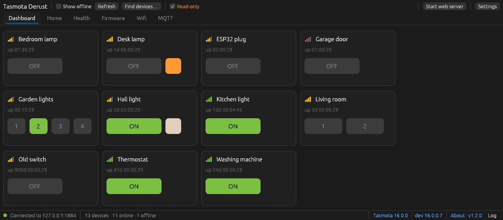

| | |
|---|---|
| **Health: uptime, restarts, load, signal** | **Firmware: outdated devices in orange** |
|  |  |
| **Wifi: SSID, AP and network of each device** | **MQTT: topic, full topic, group and fallback topics** |
| 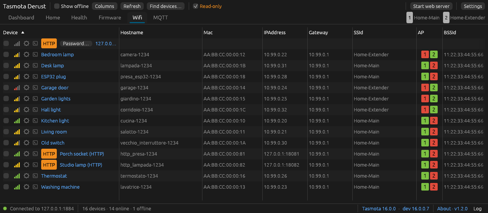 |  |
| **Home: relays, telemetry, uptime** | **Find devices on the network (HTTP)** |
|  | 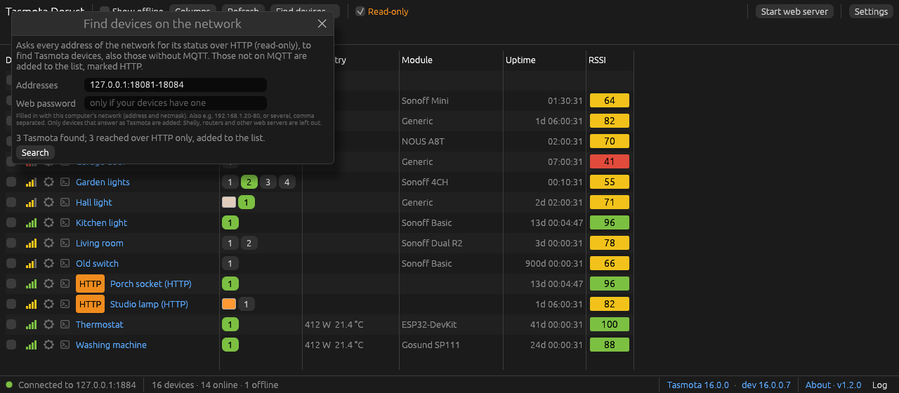 |
| **Group upgrade of ticked devices** | **Message log** |
| 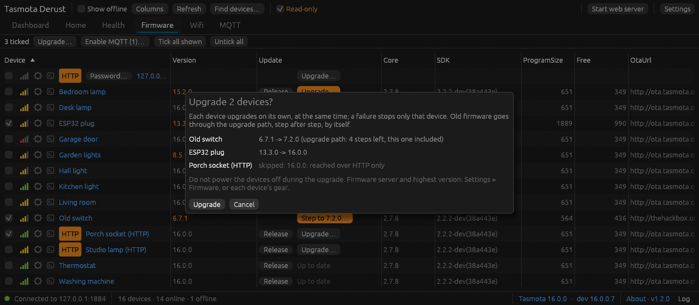 |  |
| **Settings: theme, broker, firmware, web server** | **Console of one device** |
|  | 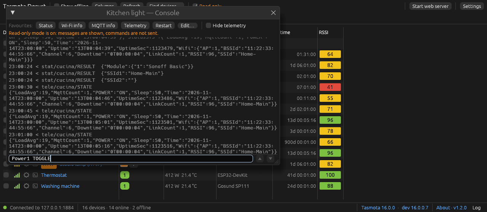 |
| **Colour wheel and sliders of a light** |  |
| 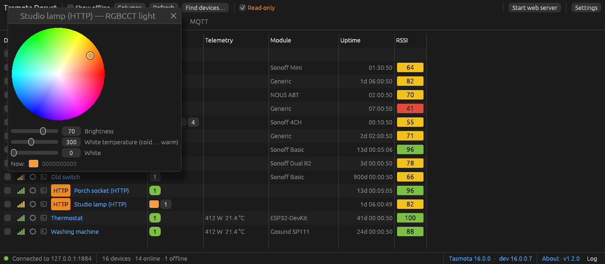 |  |

**Android**:

| | | | |
|---|---|---|---|
| **Dashboard** | **Ticking devices** | **Find devices** | **Home** |
| 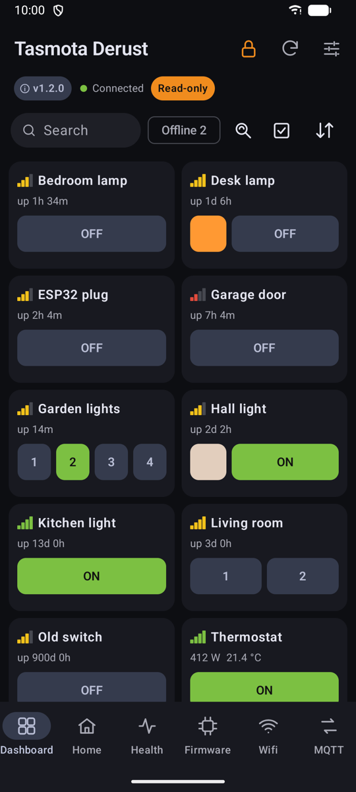 | 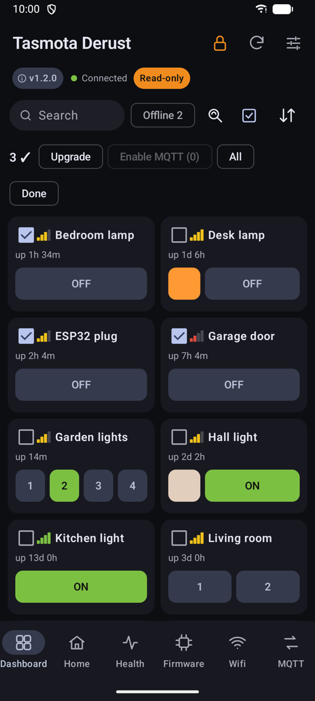 | 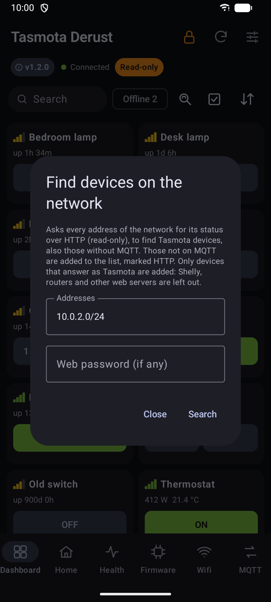 |  |
| **Health** | **Firmware** | **Wifi** | **MQTT** |
| 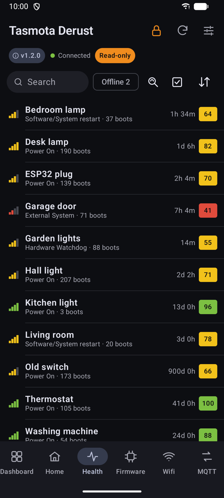 |  |  | 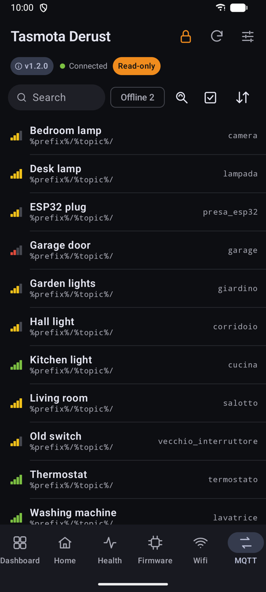 |
| **Device details** | **Read-only** | **Console** | **Colour wheel** |
|  |  | 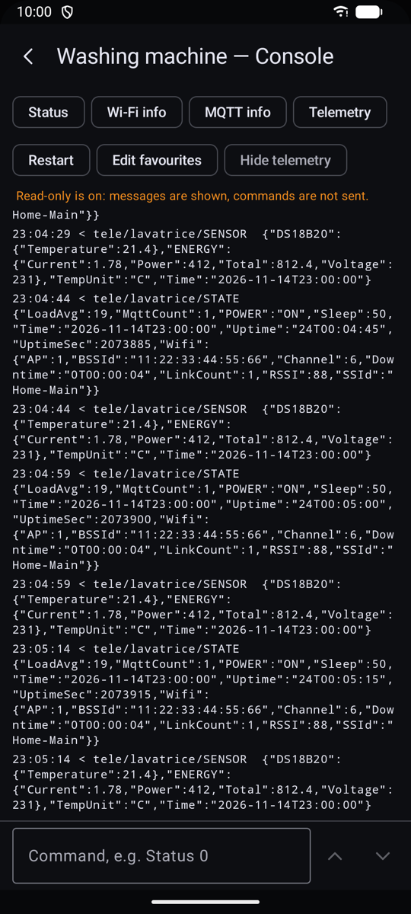 | 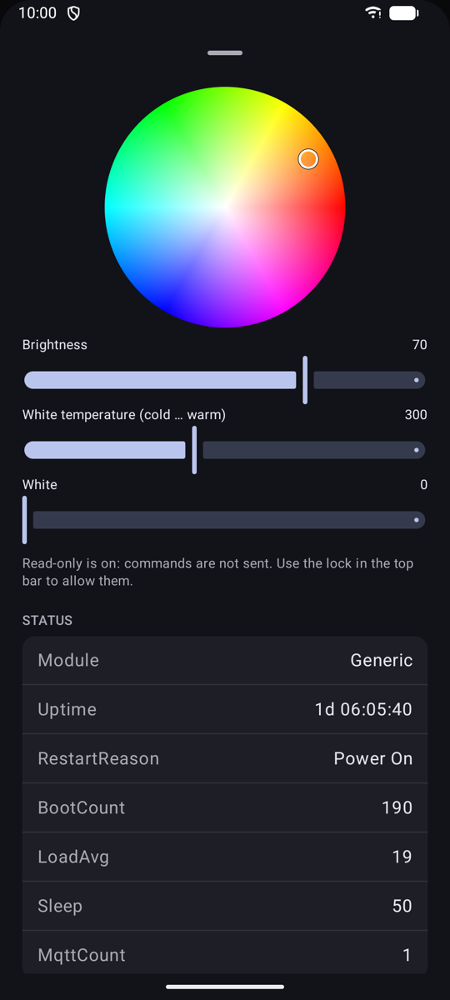 |
| **Settings** |  |  |  |
|  |  |  |  |

## Desktop app

Set the broker in **Settings** (host, port, user, password); the devices appear as they
report in. The toolbar has the views, *Show offline*, the column chooser, *Refresh*, the
**Read-only** checkbox (ticked at every start) and **Start web server**.

**Settings** has the theme, the broker and the web server (HTTPS, login). They are saved in
the user's config directory; the broker password in plain text, the web password only as a
hash (what is stored and why: [SECURITY.md](SECURITY.md#what-is-stored-where-and-how)):

| System | Config file |
|---|---|
| macOS | `~/Library/Application Support/tasmota-derust/config.json` |
| Windows | `%APPDATA%\tasmota-derust\config\config.json` |
| Linux | `~/.config/tasmota-derust/config.json` |

On Linux the desktop app needs OpenGL and either X11 or Wayland (any desktop session has them).

## Web version

`tasmota-derust-web` is a small server with the same MQTT core. It serves a page that works
on phones, tablets and desktop browsers: tables on wide screens, and on phones a compact list
with a bottom tab bar and a detail sheet per device.

It comes as two programs, so the mode is a visible choice at every launch:

```
tasmota-derust-web                          # read-only: look, never switch or upgrade
tasmota-derust-web-rw                       # read-write: commands are sent to devices
tasmota-derust-web --listen 127.0.0.1:8099  # local only (both take --listen)
tasmota-derust-web-rw --https               # HTTPS on port 8443 (self-signed certificate)
tasmota-derust-web --no-browser             # don't open the browser (also DERUST_NO_BROWSER=1)
```

Started from a terminal on a computer with a screen, it opens the page in the default browser
and prints the address (Ctrl-click it, Cmd-click on macOS). As a service or on a headless
server it only prints the address.

Each prints the address to open from other devices (this computer's network address, e.g.
`http://192.168.1.20:8080`), its mode and whether a login is required. Both read the broker
and the web login from the desktop app's config file; environment variables override them:
`DERUST_MQTT_HOST`, `DERUST_MQTT_PORT`, `DERUST_MQTT_USER`, `DERUST_MQTT_PASSWORD`,
`DERUST_WEB_USER`, `DERUST_WEB_PASSWORD`, `DERUST_WEB_HTTPS` (1/0) and `DERUST_LISTEN`.

The desktop app can run the same server: **Start web server** asks whether to start it
read-only or read-write, listens on port 8080 (8443 with HTTPS) and shows the address and the
mode. Its mode
does not follow the app's Read-only checkbox: stop the server and start it again to change it.

**Login (optional).** Set a username and password in the desktop app's **Settings** (Web
server): the browser asks for them on every visit. Only a salted hash of the password is saved,
so it cannot be read back from the config file (type a new one to change it). The desktop app's server and the two
programs read the same config file, so they always use the same login. Without one, anyone who
can reach the port can use the page: starting read-write without a login shows a warning, in
the app, on the console and as a red banner on the page. The reasons behind these choices,
and what they do not cover, are in [SECURITY.md](SECURITY.md#the-web-server-choices-and-their-limits).

**HTTPS (optional).** By default the server speaks plain HTTP, without TLS: the login and all
traffic (Wi-Fi passwords sent to devices included) travel in clear text on the network. Tick
**HTTPS** in the desktop app's Settings (or pass `--https`) to serve HTTPS on port 8443 with a
self-signed certificate. It is made once, next to the config file (`web-cert.pem`,
`web-key.pem`), and shared by the app and the two programs, so a browser exception keeps
working. Browsers warn on the first visit because no authority signed it: accept it only if
its SHA-256 fingerprint matches the one printed by the server (or shown when hovering the
address in the desktop app). Delete both files to make a new certificate, e.g. after the
computer's address changed.

The server also refuses commands sent by other web sites through a visitor's browser (their
`Origin` must be the server itself), and answers only to IP addresses and local names
(`localhost`, `nas`, `pi.local`, `box.lan`, …), so a public domain pointed at it cannot reach
it. Behind a reverse proxy with its own domain, list that name in `DERUST_ALLOWED_HOSTS`
(comma-separated).

## Android app

`android/` is a Kotlin + Jetpack Compose app for Android 13 or newer. The device logic is the
same Rust core, compiled for Android with `cargo-ndk` and called from Kotlin through UniFFI
(`crates/mobile`); Gradle builds the Rust part automatically.

Broker settings are entered in the app, stored only on the phone and excluded from backups.
**Read-only is on at every start**: commands are sent only after opening the lock in the top
bar (it asks first). On Android 17 the app asks for permission to reach devices on the local
network.

## Building and contributing

Building every version (macOS, Windows, Linux, Android) with or without `make`, the device
simulator, the Trivy security checks and the release process are in
[DEVELOPMENT.md](DEVELOPMENT.md). The architecture and roadmap are in [DESIGN.md](DESIGN.md).

## Status

The basic functions are all there: discovery, the device views, relays, Wi-Fi AP switching,
firmware upgrades from the device's OtaUrl, read-only mode, desktop, web and Android.

Missing, compared with tdmgr: the advanced editors in its top tabs (rules, timers, switches,
buttons, power settings and the like) and a per-device console. See the roadmap in
[DESIGN.md](DESIGN.md#roadmap).

## License

Licensed under either of

- Apache License, Version 2.0 ([LICENSE-APACHE](LICENSE-APACHE) or <http://www.apache.org/licenses/LICENSE-2.0>)
- MIT license ([LICENSE-MIT](LICENSE-MIT) or <http://opensource.org/licenses/MIT>)

at your option.

Unless you explicitly state otherwise, any contribution intentionally submitted
for inclusion in this project by you, as defined in the Apache-2.0 license,
shall be dual licensed as above, without any additional terms or conditions.
