# Upgrading old Tasmota firmware: a recorded run

A real ESP8266, flashed with **Tasmota 6.7.1**, upgraded to **16.0.0** with Tasmota Derust 0.3.0 (development build with the fixes made during this test), following the official [upgrade path](https://tasmota.github.io/docs/Upgrading/#upgrade-flow). Recorded on 15 November 2026, from 19:26:19 to 19:29:00.

- **Device**: Wemos D1 mini (ESP8266EX, 4 MB flash), flashed by serial with the official `release-6.7.1/sonoff-basic.bin`. Its header declares 1 MB of flash, so Tasmota behaves like on a 1 MB Sonoff Basic.
- **Network**: the user's own MQTT broker. Commands were sent only to this device (topic `test`); read-only mode was off only for it.
- **Screenshots**: Tasmota Derust's web page in a headless browser, filtered to this one device and showing only the first three columns of the Firmware view (Device, Version, Update), and the upgrade dialog on its own. One screenshot is taken at every change of state; each step was started as soon as the previous one had finished.

## Summary

| Step | From | To | Image (OtaUrl set by the app) | Free flash checked | Time |
|---:|---|---|---|---|---|
| 1 | 6.7.1 | 7.2.0 | `http://ota.tasmota.com/tasmota/release-7.2.0/tasmota-lite.bin` | Image 464 KB, free flash 544 KB: it fits. | 19:26:19 → 19:26:49 |
| 2 | 7.2.0 | 8.5.1 | `http://ota.tasmota.com/tasmota/release-8.5.1/tasmota-lite.bin` | Image 474 KB, free flash 540 KB: it fits. | 19:26:59 → 19:27:33 |
| 3 | 8.5.1 | 9.1.0 | `http://ota.tasmota.com/tasmota/release-9.1.0/tasmota-lite.bin.gz` | Image 339 KB, free flash 528 KB: it fits. | 19:27:42 → 19:28:15 |
| 4 | 9.1.0 | 16.0.0 | `http://ota.tasmota.com/tasmota/release/tasmota.bin.gz` | no check (last step) | 19:28:19 → 19:28:56 |

## OtaUrl, step by step

The device kept the default OtaUrl of its 6.7.1 days, on a domain that no longer exists. The app sets the right image before every step (`OtaUrl <url>`, then `Upgrade 1`):

1. `http://thehackbox.org/tasmota/release/sonoff.bin` (original)
2. `http://ota.tasmota.com/tasmota/release-7.2.0/tasmota-lite.bin` (step 1)
3. `http://ota.tasmota.com/tasmota/release-8.5.1/tasmota-lite.bin` (step 2)
4. `http://ota.tasmota.com/tasmota/release-9.1.0/tasmota-lite.bin.gz` (step 3)
5. `http://ota.tasmota.com/tasmota/release/tasmota.bin.gz` (final)

## Step 1: 6.7.1 → 7.2.0

**19:26:19**, before the step: version `6.7.1(basic)`, OtaUrl `http://thehackbox.org/tasmota/release/sonoff.bin`, program 456 KB, free flash 544 KB.

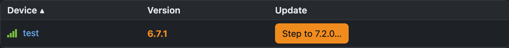

The dialog the upgrade button opens:

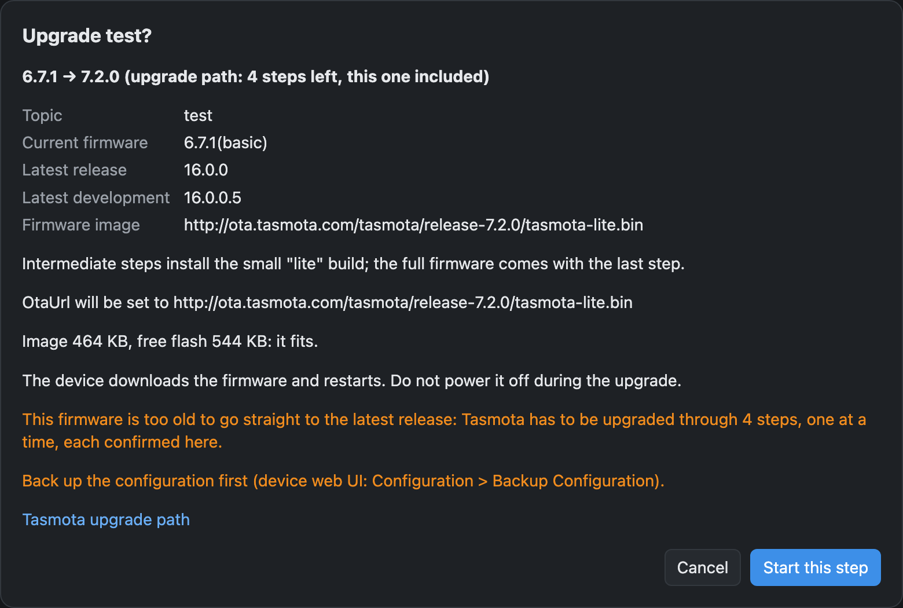

After **Start this step**:

- **19:26:21**: Command sent… (device online)

  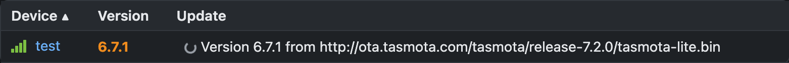

- **19:26:23**: Version 6.7.1 from http://ota.tasmota.com/tasmota/release-7.2.0/tasmota-lite.bin (device online)

  

- **19:26:25**: Restarting… (device offline)

  

- **19:26:32**: Restarting… (device back on MQTT, waiting for its status)

  

- **19:26:34**: Restarting… (device online)

  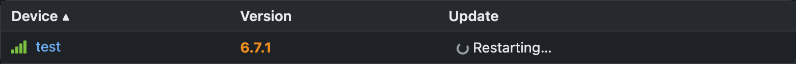

- **19:26:49**: Upgraded 6.7.1 → 7.2.0. 3 steps left: upgrade again for the next one. (device online)

  

## Step 2: 7.2.0 → 8.5.1

**19:26:59**, before the step: version `7.2.0(lite)`, OtaUrl `http://ota.tasmota.com/tasmota/release-7.2.0/tasmota-lite.bin`, program 463 KB, free flash 540 KB.


The dialog the upgrade button opens:


After **Start this step**:

- **19:27:01**: Command sent… (device online)

  

- **19:27:03**: Version 7.2.0 from http://ota.tasmota.com/tasmota/release-8.5.1/tasmota-lite.bin (device online)

  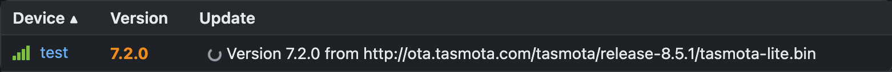

- **19:27:05**: Restarting… (device offline)

  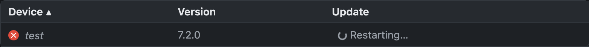

- **19:27:17**: Restarting… (device back on MQTT, waiting for its status)

  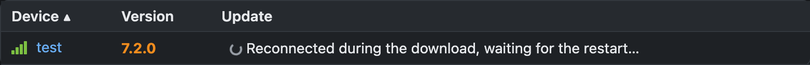

- **19:27:19**: Successful. Restarting (device online)

  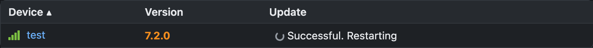

- **19:27:33**: Upgraded 7.2.0 → 8.5.1. 2 steps left: upgrade again for the next one. (device online)

  

## Step 3: 8.5.1 → 9.1.0

**19:27:42**, before the step: version `8.5.1(lite)`, OtaUrl `http://ota.tasmota.com/tasmota/release-8.5.1/tasmota-lite.bin`, program 473 KB, free flash 528 KB.

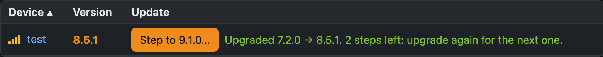

The dialog the upgrade button opens:

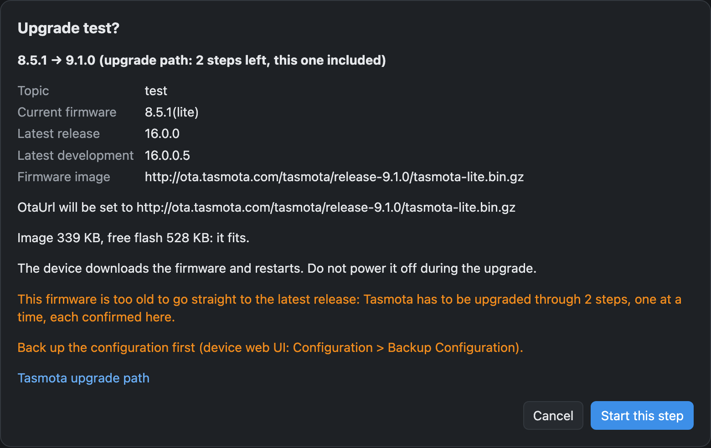

After **Start this step**:

- **19:27:44**: Command sent… (device online)

  

- **19:27:46**: Version 8.5.1 from http://ota.tasmota.com/tasmota/release-9.1.0/tasmota-lite.bin.gz (device online)

  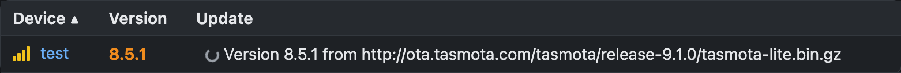

- **19:27:48**: Restarting… (device offline)

  

- **19:27:57**: Restarting… (device back on MQTT, waiting for its status)

  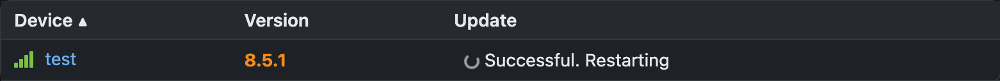

- **19:27:59**: Successful. Restarting (device online)

  

- **19:28:15**: Upgraded 8.5.1 → 9.1.0. 1 step left: upgrade again for the last one. (device online)

  

## Step 4: 9.1.0 → 16.0.0

**19:28:19**, before the step: version `9.1.0(lite)`, OtaUrl `http://ota.tasmota.com/tasmota/release-9.1.0/tasmota-lite.bin.gz`, program 473 KB, free flash 528 KB.

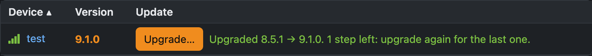

The dialog the upgrade button opens:

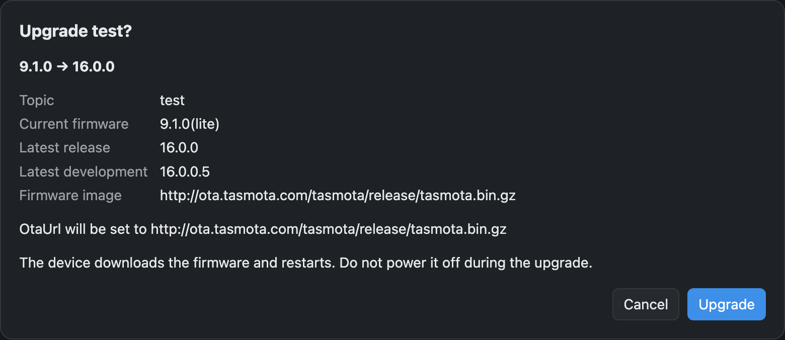

After **Start this step**:

- **19:28:21**: Command sent… (device online)

  

- **19:28:23**: Version 9.1.0 from http://ota.tasmota.com/tasmota/release/tasmota.bin.gz (device online)

  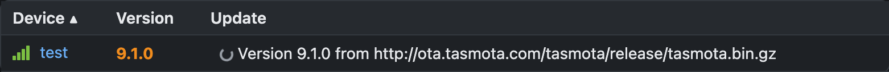

- **19:28:25**: Restarting… (device offline)

  

- **19:28:38**: Restarting… (device back on MQTT, waiting for its status)

  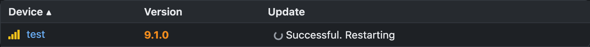

- **19:28:56**: Upgraded 9.1.0 → 16.0.0 (device online)

  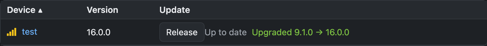

## Result

19:29:00: **16.0.0(release-tasmota)**, OtaUrl `http://ota.tasmota.com/tasmota/release/tasmota.bin.gz`, program 651 KB, free flash 352 KB. The upgrade button is gone: the device runs the latest release.

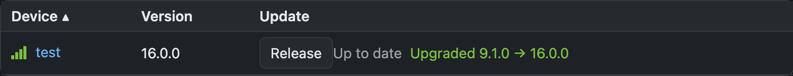

## Full log

What the recording script printed (time, state, firmware version, OtaUrl, upgrade text):

```
19:26:19 step1:before | 6.7.1(basic) | http://thehackbox.org/tasmota/release/sonoff.bin | None
  POST upgrade -> 204 
19:26:21 step1:sent | 6.7.1(basic) | http://ota.tasmota.com/tasmota/release-7.2.0/tasmota-lite.bin | Command sent…
19:26:23 step1:progress | 6.7.1(basic) | http://ota.tasmota.com/tasmota/release-7.2.0/tasmota-lite.bin | Version 6.7.1 from http://ota.tasmota.com/tasmota/release-7.2.0/tasmota-lite.bin
19:26:25 step1:restarting | 6.7.1(basic) | http://ota.tasmota.com/tasmota/release-7.2.0/tasmota-lite.bin | Restarting…
19:26:32 step1:restarting | 6.7.1(basic) | http://ota.tasmota.com/tasmota/release-7.2.0/tasmota-lite.bin | Restarting…
19:26:34 step1:restarting | 6.7.1(basic) | http://ota.tasmota.com/tasmota/release-7.2.0/tasmota-lite.bin | Restarting…
19:26:49 step1:done | 7.2.0(lite) | http://ota.tasmota.com/tasmota/release-7.2.0/tasmota-lite.bin | Upgraded 6.7.1 → 7.2.0. 3 steps left: upgrade again for the next one.
19:26:59 step2:before | 7.2.0(lite) | http://ota.tasmota.com/tasmota/release-7.2.0/tasmota-lite.bin | Upgraded 6.7.1 → 7.2.0. 3 steps left: upgrade again for the next one.
  POST upgrade -> 204 
19:27:01 step2:sent | 7.2.0(lite) | http://ota.tasmota.com/tasmota/release-8.5.1/tasmota-lite.bin | Command sent…
19:27:03 step2:progress | 7.2.0(lite) | http://ota.tasmota.com/tasmota/release-8.5.1/tasmota-lite.bin | Version 7.2.0 from http://ota.tasmota.com/tasmota/release-8.5.1/tasmota-lite.bin
19:27:05 step2:restarting | 7.2.0(lite) | http://ota.tasmota.com/tasmota/release-8.5.1/tasmota-lite.bin | Restarting…
19:27:17 step2:restarting | 7.2.0(lite) | http://ota.tasmota.com/tasmota/release-8.5.1/tasmota-lite.bin | Restarting…
19:27:19 step2:progress | 7.2.0(lite) | http://ota.tasmota.com/tasmota/release-8.5.1/tasmota-lite.bin | Successful. Restarting
19:27:33 step2:done | 8.5.1(lite) | http://ota.tasmota.com/tasmota/release-8.5.1/tasmota-lite.bin | Upgraded 7.2.0 → 8.5.1. 2 steps left: upgrade again for the next one.
19:27:42 step3:before | 8.5.1(lite) | http://ota.tasmota.com/tasmota/release-8.5.1/tasmota-lite.bin | Upgraded 7.2.0 → 8.5.1. 2 steps left: upgrade again for the next one.
  POST upgrade -> 204 
19:27:44 step3:sent | 8.5.1(lite) | http://ota.tasmota.com/tasmota/release-9.1.0/tasmota-lite.bin.gz | Command sent…
19:27:46 step3:progress | 8.5.1(lite) | http://ota.tasmota.com/tasmota/release-9.1.0/tasmota-lite.bin.gz | Version 8.5.1 from http://ota.tasmota.com/tasmota/release-9.1.0/tasmota-lite.bin.gz
19:27:48 step3:restarting | 8.5.1(lite) | http://ota.tasmota.com/tasmota/release-9.1.0/tasmota-lite.bin.gz | Restarting…
19:27:57 step3:restarting | 8.5.1(lite) | http://ota.tasmota.com/tasmota/release-9.1.0/tasmota-lite.bin.gz | Restarting…
19:27:59 step3:progress | 8.5.1(lite) | http://ota.tasmota.com/tasmota/release-9.1.0/tasmota-lite.bin.gz | Successful. Restarting
19:28:15 step3:done | 9.1.0(lite) | http://ota.tasmota.com/tasmota/release-9.1.0/tasmota-lite.bin.gz | Upgraded 8.5.1 → 9.1.0. 1 step left: upgrade again for the last one.
19:28:19 step4:before | 9.1.0(lite) | http://ota.tasmota.com/tasmota/release-9.1.0/tasmota-lite.bin.gz | Upgraded 8.5.1 → 9.1.0. 1 step left: upgrade again for the last one.
  POST upgrade -> 204 
19:28:21 step4:sent | 9.1.0(lite) | http://ota.tasmota.com/tasmota/release/tasmota.bin.gz | Command sent…
19:28:23 step4:progress | 9.1.0(lite) | http://ota.tasmota.com/tasmota/release/tasmota.bin.gz | Version 9.1.0 from http://ota.tasmota.com/tasmota/release/tasmota.bin.gz
19:28:25 step4:restarting | 9.1.0(lite) | http://ota.tasmota.com/tasmota/release/tasmota.bin.gz | Restarting…
19:28:38 step4:restarting | 9.1.0(lite) | http://ota.tasmota.com/tasmota/release/tasmota.bin.gz | Restarting…
19:28:56 step4:done | 16.0.0(release-tasmota) | http://ota.tasmota.com/tasmota/release/tasmota.bin.gz | Upgraded 9.1.0 → 16.0.0
19:29:00 step5:before | 16.0.0(release-tasmota) | http://ota.tasmota.com/tasmota/release/tasmota.bin.gz | Upgraded 9.1.0 → 16.0.0
UP TO DATE
END
```

## How this was recorded

`dist` builds of Tasmota Derust, its web server running on the Mac (127.0.0.1 only) and connected to the broker. A script started each step through the same API the upgrade button uses (`POST /api/devices/test/upgrade`), polled `/api/state` once a second and, at every change, took a screenshot of `/?view=firmware&only=test&cols=3&bare=1` (and of `&upgrade=test` for the dialog) with headless Chrome.
